# Pulso · Plataforma de datos de clientes

Tablero de valor de clientes con **datos reales** de un e-commerce mayorista (Online Retail II, 1 millón de líneas de venta):
API **GraphQL**, frontend **React con SSR**, **design system** propio en SCSS documentado en **Storybook**, y un **asistente de datos**
que responde preguntas frecuentes con las mismas consultas que usa el tablero.

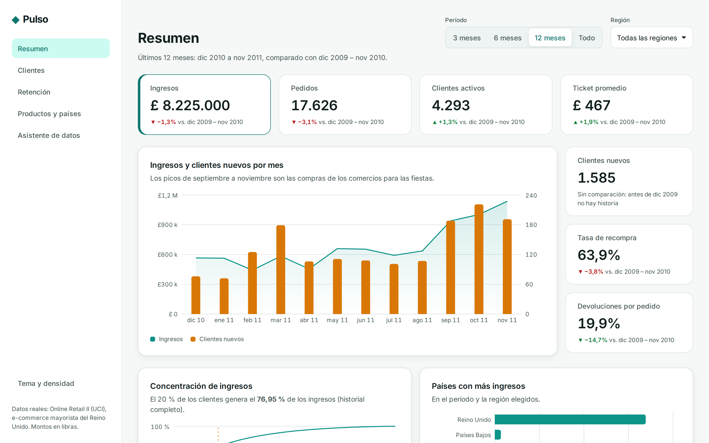

## El caso en 5 partes

| Área | Qué hay | Documento |
| --- | --- | --- |
| 01 · Producto | Problema, personas, hipótesis, North Star, priorización RICE, MVP y roadmap | [docs/01-producto](docs/01-producto/README.md) |
| 02 · Diseño & UX/UI | Arquitectura de información, decisiones de diseño, tokens, design system, WCAG 2.2 AA, test de usabilidad | [docs/02-diseno](docs/02-diseno/README.md) |
| 03 · Programación full-stack | Arquitectura, SSR con Vite, GraphQL, TanStack Query + Zustand, testing, CI/CD | [docs/03-desarrollo](docs/03-desarrollo/README.md) |
| 04 · Datos & BI | Pipeline en Python, SQL, RFM, cohortes, Pareto, modelo y medidas para Power BI, hallazgos | [docs/04-datos](docs/04-datos/README.md) |
| 05 · Gestión y agilidad | Scrum en 4 sprints, backlog para Jira, velocidad, burndown, riesgos, RACI, retros | [docs/05-gestion](docs/05-gestion/README.md) |

Los datos de ventas son reales. Las personas, entrevistas, test de usabilidad y ceremonias con equipo son **simulados** y están marcados así en cada documento.

## Qué muestra

| Resumen en modo oscuro | Clientes por segmento RFM |
| --- | --- |
| 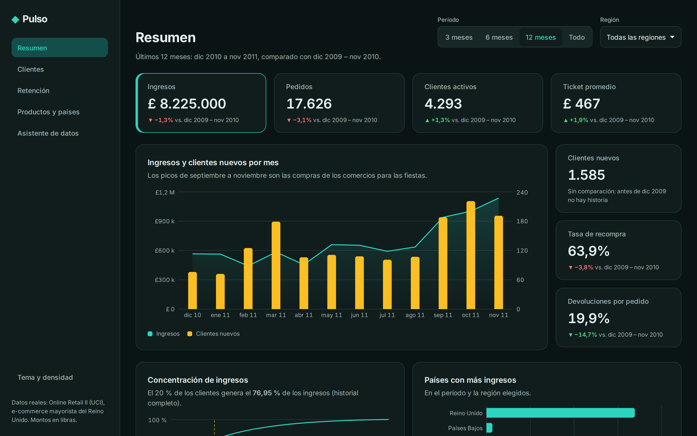 | 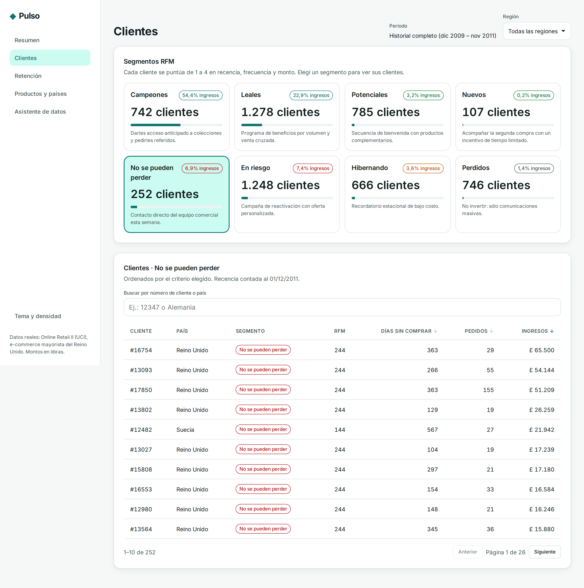 |

| Retención por cohorte | Asistente de datos |
| --- | --- |
| 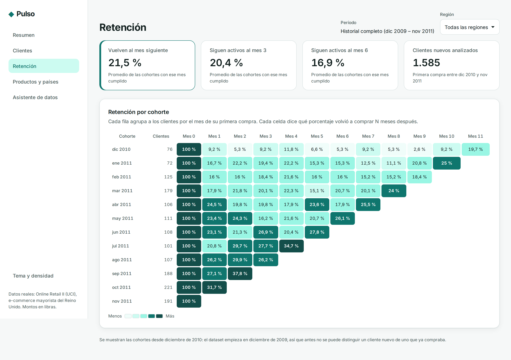 | 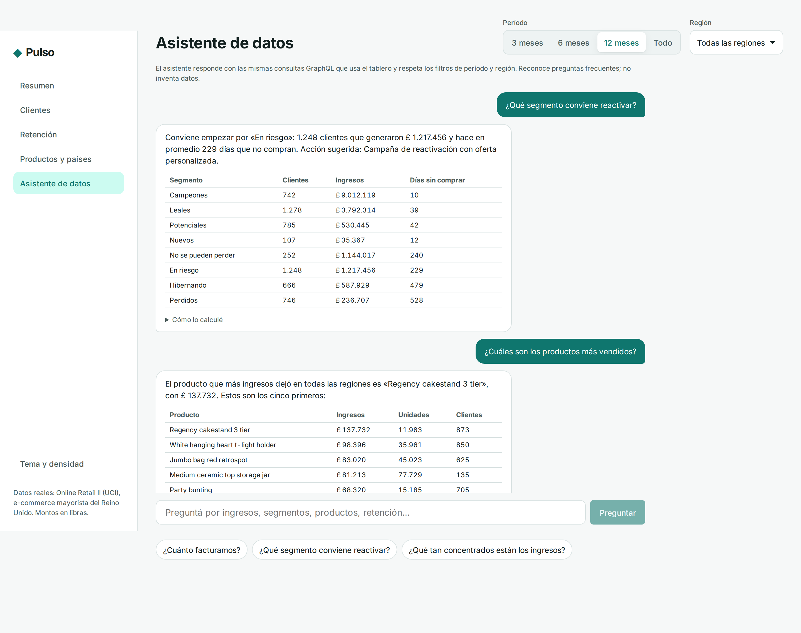 |

| Celular | Storybook |
| --- | --- |
| 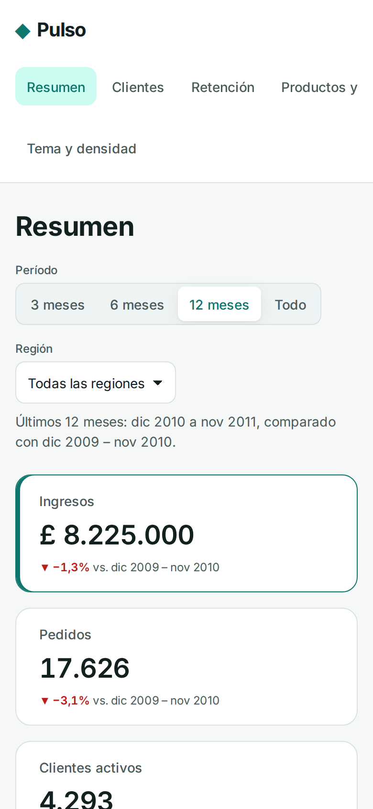 | 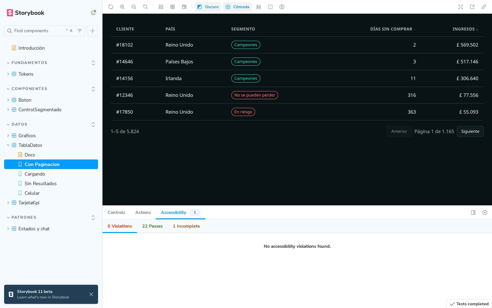 |

## Decisiones, anotadas

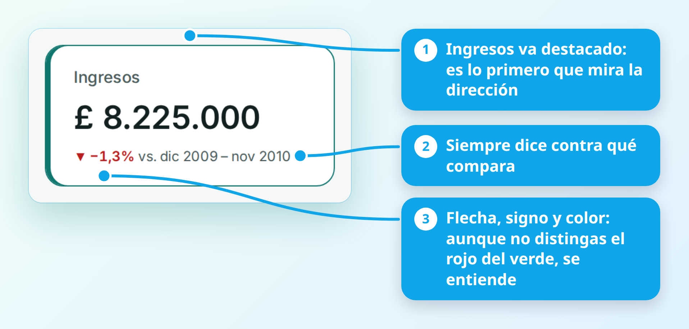

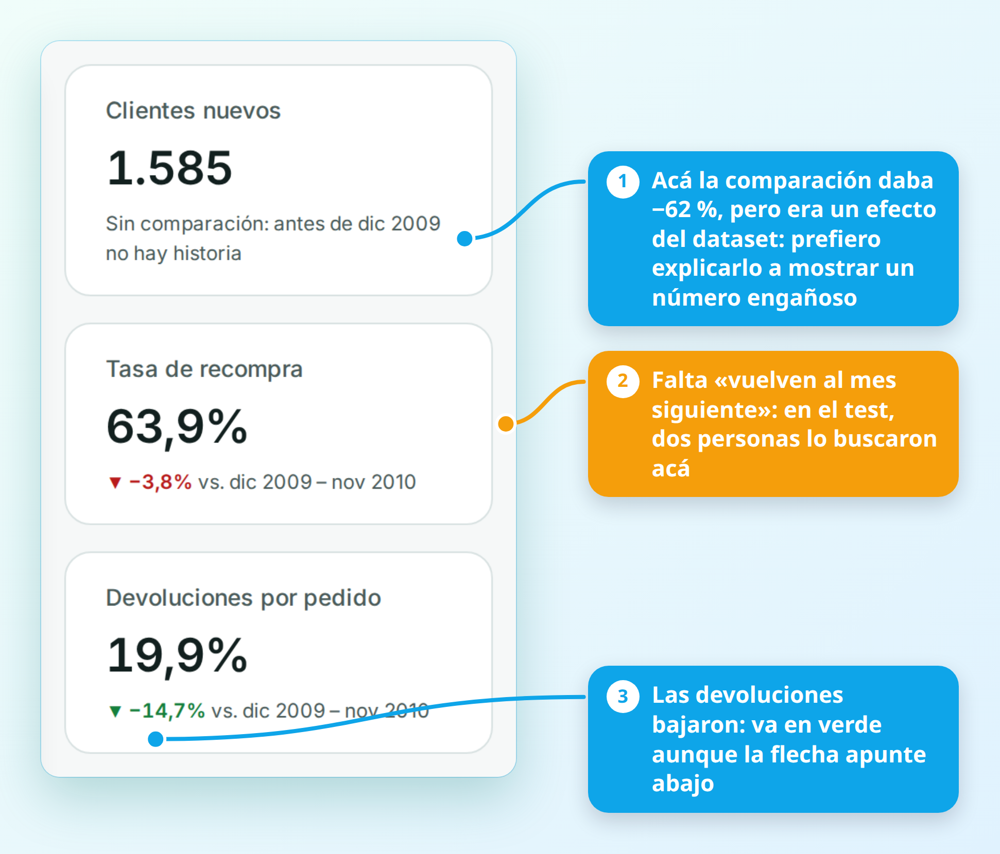

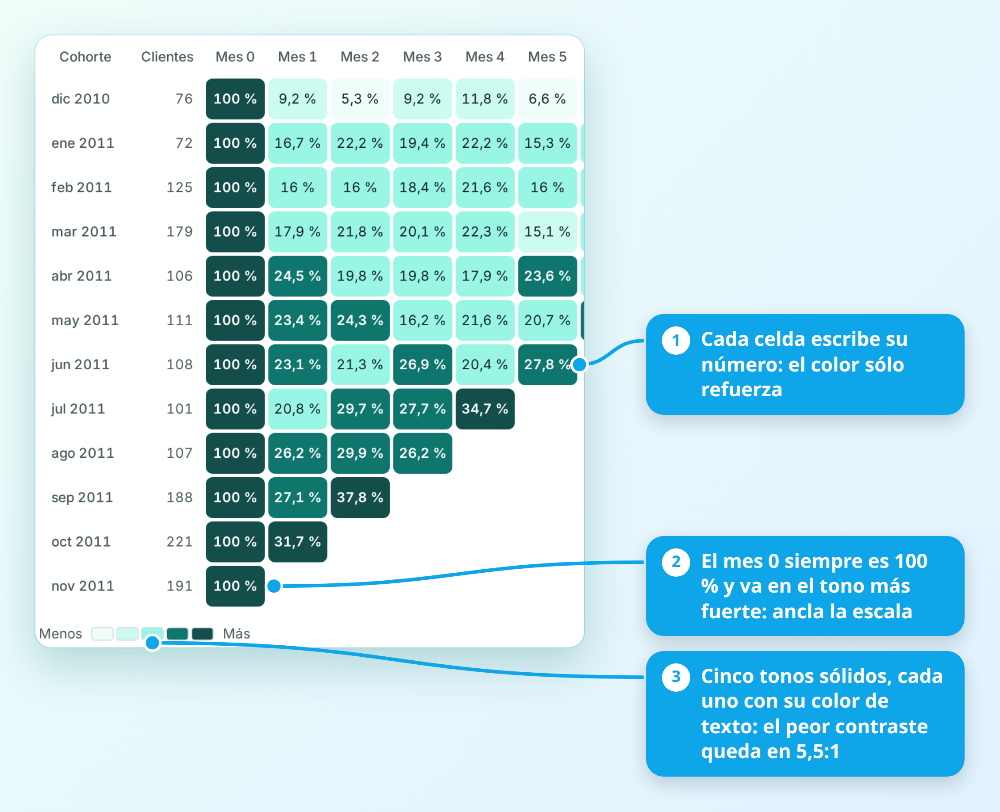

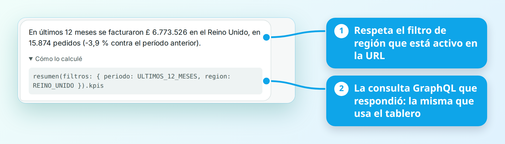

Todas las capturas anotadas están en [docs/capturas/anotadas](docs/capturas/anotadas) y se regeneran con `node web/scripts/anotar.mjs`.

## Stack

| | |
| --- | --- |
| **Lenguajes** | TypeScript, Python, SQL |
| **Frontend** | React 19, Vite (SSR), React Router, TanStack Query, Zustand, SCSS Modules, Recharts |
| **Backend** | Node.js, Apollo Server (GraphQL), Express, better-sqlite3 |
| **Datos** | pandas, SQLite, Power BI (modelo estrella + DAX) |
| **Calidad** | Jest, React Testing Library, Playwright, axe-core, Storybook (addon a11y), ESLint (jsx-a11y) |
| **CI/CD** | GitHub Actions, Azure Pipelines, GitHub Pages (Storybook), Render |

## Cómo correrlo

```bash
git clone https://github.com/Codeginny/pulso-react-dashboard.git
cd pulso-react-dashboard
```

Requiere Node 20+ (y Python 3.11+ sólo si querés regenerar los datos).

```bash
npm install
npm run dev
```

Abre la API en `http://localhost:4000` y el tablero en `http://localhost:5173`. La base `data/pulso.db` ya viene en el repo.

| Comando | Qué hace |
| --- | --- |
| `npm test` | Tests de la API y del frontend (Jest) |
| `npm run e2e` | Playwright en escritorio y celular, con axe |
| `npm run storybook` | Design system en `http://localhost:6006` |
| `npm run lint` / `npm run typecheck` | ESLint y TypeScript |
| `npm run build` | Build de producción de API y web |
| `npm run datos` | Regenera `data/pulso.db` desde el CSV (ver [data/README.md](data/README.md)) |

## Estructura

```
api/          API GraphQL (esquema, repositorio SQL, asistente) + tests
web/
  server.ts   Servidor Express: SSR + proxy /graphql
  src/
    design-system/   tokens SCSS, componentes, historias y tests
    pages/           Resumen, Clientes, Retención, Productos, Asistente
    store/           Zustand (filtros y preferencias) por request
    api/             consultas GraphQL tipadas con TanStack Query
  e2e/        Playwright + axe
data/         pipeline.py, sql/, powerbi/, pulso.db
docs/         las 5 partes del caso + capturas
```

## Números

- **13** tests de API, **28** tests de componentes y lógica, **38** tests end-to-end.
- **0** violaciones de accesibilidad (axe, WCAG 2.2 AA) en 5 secciones × 2 temas × escritorio y celular.
- **29** historias de Storybook.
- Hallazgo principal de los datos: el 20 % de los clientes genera el **77 %** de los ingresos, y hay **£ 2,36 M** de valor histórico en
  clientes que llevan más de 7 meses sin comprar.

---

Datos: *Online Retail II*, Daqing Chen, UCI Machine Learning Repository (CC BY 4.0).
