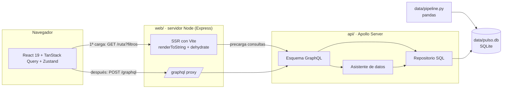

# 03 · Programación full-stack

## Arquitectura

| Capa | Tecnología | Responsabilidad |
| --- | --- | --- |
| Datos | Python, pandas, SQLite | Limpiar el CSV, calcular RFM, cohortes y agregados |
| API | Node.js, TypeScript, Apollo Server, better-sqlite3 | Esquema GraphQL tipado, consultas parametrizadas, asistente |
| Servidor web | Express, Vite SSR | Renderizar cada página con datos, proxy a la API, cabeceras de seguridad |
| Frontend | React 19, TypeScript, TanStack Query, Zustand, React Router | Interfaz, caché de datos, filtros y preferencias |
| Estilos | SCSS Modules + variables CSS | Design system con tokens y modo oscuro |
| Gráficos | Recharts | Envoltorios propios con tokens y tablas accesibles |
| Calidad | Jest, Testing Library, Playwright, axe-core, Storybook, ESLint | Unitarios, e2e, accesibilidad, documentación |
| CI/CD | GitHub Actions, Azure Pipelines, Render | Tests en cada push, Storybook publicado, deploy |

## Decisiones técnicas

### SSR con Vite en lugar de Next.js

El otro proyecto de mi portfolio (Synthetica Health) usa Next.js App Router. Acá quise armar el SSR "a mano" con Vite para
entender y mostrar qué resuelve un framework por debajo:

1. Express recibe `GET /clientes?region=INTERNACIONAL`.
2. `entry-server.tsx` lee los filtros de la URL y las preferencias de la cookie.
3. Busca la ruta y ejecuta su `precargar()`: las mismas `queryOptions` que usa el componente, contra la API.
4. `renderToString` arma el HTML con los datos ya cargados.
5. `dehydrate()` serializa la caché de TanStack Query en `window.__PULSO__` (escapando `<` para evitar XSS).
6. En el navegador, `hydrateRoot` + `HydrationBoundary` reutilizan esa caché: **no se repite ninguna consulta** al hidratar.

Resultado: el primer HTML ya trae los KPIs (lo verifica un test de Playwright pidiendo la página sin JavaScript), y el tema
guardado se pinta desde el servidor, sin parpadeo de modo claro a oscuro.

Si la API falla durante el SSR, la página igual se renderiza (`Promise.allSettled`) y el navegador reintenta la consulta.

### GraphQL

- **Esquema pensado para la pantalla, no para las tablas.** `resumen(filtros)` devuelve período, KPIs y serie en una sola consulta.
- **Enums para los filtros** (`Periodo`, `Region`, `OrdenClientes`): un valor inválido lo rechaza GraphQL antes de llegar al código.
- **Campos documentados** con descripciones (`variacion: 0.12 = +12 %`, `mejorSiSube`), visibles en la introspección.
- **Límites en la API:** `porPagina` se recorta a 50 y la pregunta del asistente a 300 caracteres.
- **Consultas SQL parametrizadas** siempre; el único texto que se arma es el `ORDER BY`, y sale de un diccionario cerrado.

### Estado: qué va en TanStack Query y qué en Zustand

| Estado | Dónde | Por qué |
| --- | --- | --- |
| Datos del servidor | TanStack Query | Caché, deduplicación, reintentos, datos anteriores mientras llegan los nuevos, hidratación SSR |
| Filtros (período, región) | Zustand + URL | Se comparten entre secciones; la URL los hace compartibles y renderizables en el servidor |
| Preferencias (tema, densidad) | Zustand + cookie | La cookie permite pintar el tema correcto en el SSR |
| Búsqueda, orden y página de la tabla | `useState` | Son locales a la pantalla |

Los stores de Zustand se crean **por request** dentro de un Provider (no como módulos globales): en SSR un store global se
compartiría entre usuarios distintos.

### El asistente de datos

No genera texto libre. Normaliza la pregunta (minúsculas, sin tildes), reconoce una de 10 intenciones por palabras clave y responde
con **las mismas funciones del repositorio que usa el tablero**. Cada respuesta incluye la consulta usada ("Cómo lo calculé").
Es una decisión de producto (hipótesis H4) y de confianza: cero respuestas inventadas, todo reproducible y testeable.
El diseño deja la puerta abierta para conectar un modelo de lenguaje después, que elija la intención y los parámetros pero siga
respondiendo con datos de la API.

### Seguridad

- Cabeceras `X-Content-Type-Options`, `X-Frame-Options: DENY`, `Referrer-Policy`; sin `X-Powered-By`.
- La API no se expone al navegador: el servidor web hace de proxy (`/graphql`) con límite de 20 kB por cuerpo.
- Apollo Server con prevención de CSRF activa (por defecto).
- Estado SSR serializado con escape de `<`.
- Base de datos abierta en modo sólo lectura.

## Testing

| Nivel | Herramienta | Cantidad | Qué cubre |
| --- | --- | ---: | --- |
| API | Jest | 13 | KPIs y comparación, segmentos que suman el total, paginación y límites, cohortes, Pareto, intenciones del asistente |
| Componentes y lógica | Jest + Testing Library | 28 | KPI accesible, radiogroup con teclado, tabla con `aria-sort`, paginación, formato es-AR, filtros en URL y cookie, asistente con fetch simulado |
| End-to-end | Playwright (escritorio y Pixel 7) | 38 | SSR con datos, filtros por URL, 404, tema desde cookie, navegación con foco, asistente |
| Accesibilidad | axe-core en Playwright | incluido | 5 secciones × 2 temas × 2 dispositivos, WCAG 2.2 AA |
| Visual / documentación | Storybook + addon a11y | 29 historias | Cada componente en claro/oscuro y densidades; prueba de interacción del control segmentado |

Los tests se escriben desde lo que ve la persona usuaria (`getByRole`, `getByLabelText`), no desde la implementación:
si un test no encuentra un botón por su nombre accesible, un lector de pantalla tampoco.

## Bugs que encontraron los tests

- **axe:** el mapa de calor con transparencias tenía celdas sin contraste suficiente → niveles sólidos.
- **axe:** la tabla con scroll horizontal no se podía enfocar con teclado → contenedor con `tabIndex` y `role="region"`.
- **Playwright (celular):** la página se desbordaba 216 px porque la columna del grid crecía con el menú → `minmax(0, 1fr)`.
- **Uso real del asistente:** "¿Qué segmento conviene reactivar?" respondía "En riesgo" porque "en" aparece dentro de "segmento" →
  alias propios por segmento y un test de regresión.

## CI/CD

- **`.github/workflows/ci.yml`:** lint, tipos, tests de API y frontend con cobertura, build, y Playwright + axe. Sube el reporte si falla.
- **`.github/workflows/storybook.yml`:** publica Storybook en GitHub Pages cuando cambia el design system.
- **`azure-pipelines.yml`:** el mismo pipeline para Azure DevOps, con Storybook como artefacto.
- **`render.yaml`:** blueprint para desplegar la API y el servidor SSR como dos servicios en Render.
