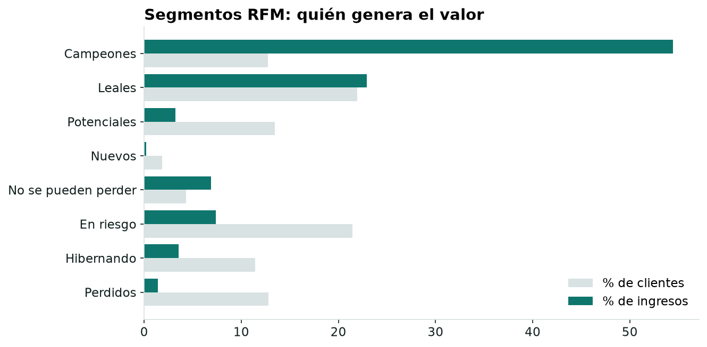
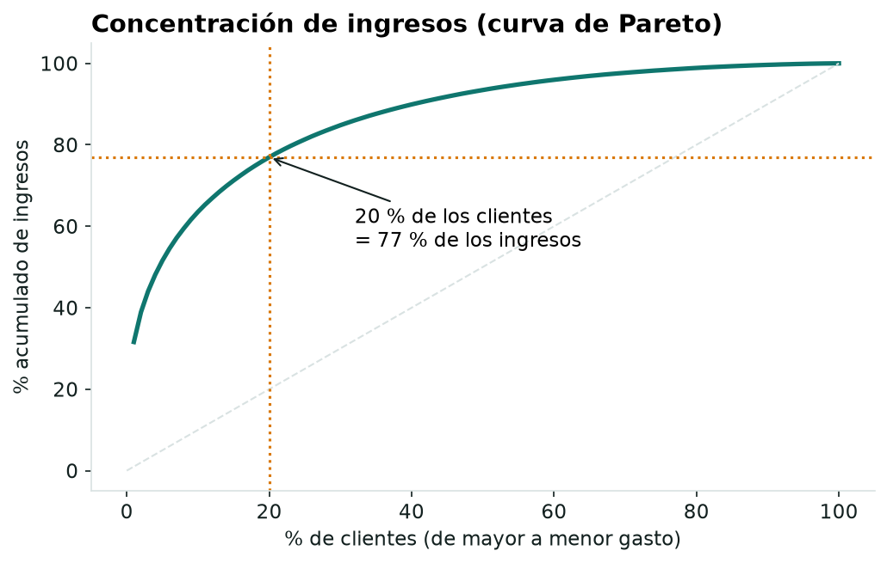
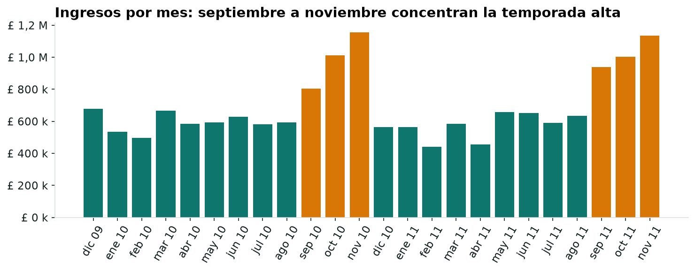
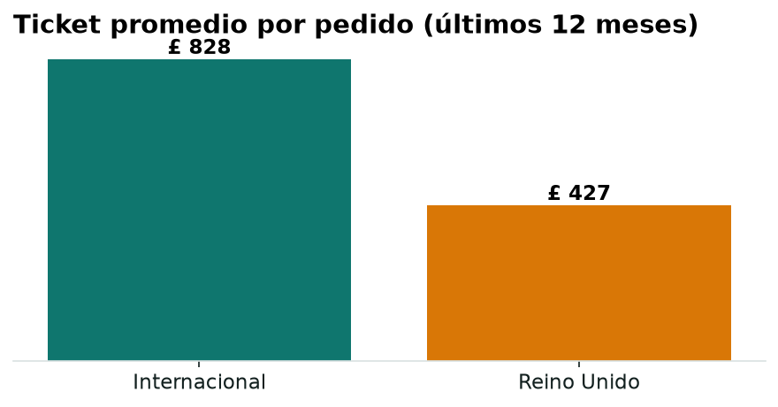
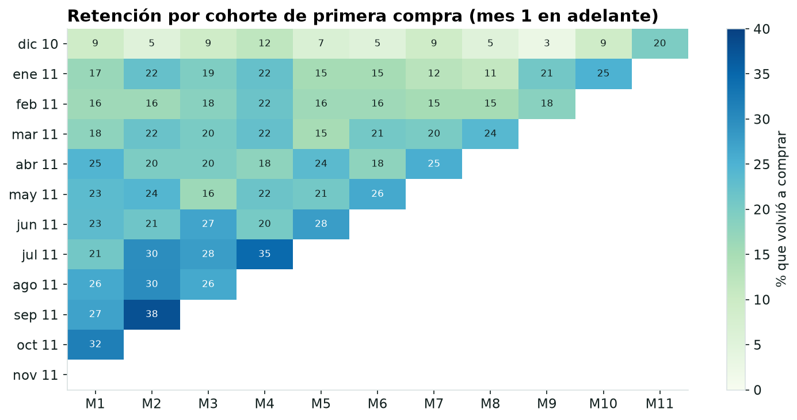

# 04 · Datos & Business Intelligence

> **Datos reales.** Todo lo de este documento sale del dataset público *Online Retail II* (UCI Machine Learning Repository):
> ventas de un e-commerce mayorista de regalos del Reino Unido entre diciembre de 2009 y diciembre de 2011. Montos en libras (£).

## Pregunta de negocio

¿Dónde está el valor de la base de clientes, quién se está yendo y cuándo conviene actuar?
El tablero de Pulso responde eso con cuatro análisis: KPIs del período, segmentación RFM, cohortes de retención y concentración (Pareto).

## Pipeline

```
online_retail_II.csv (1.067.371 filas, 95 MB)
        │  data/pipeline.py (pandas)
        ▼
  limpieza → modelo RFM → agregados por ventana y región
        │  data/sql/esquema.sql (índices, catálogos, vistas)
        ▼
  data/pulso.db (SQLite, 924 KB) ──► API GraphQL ──► dashboard
        │
        ├─► data/powerbi/exportar.py ──► CSV en modelo estrella + medidas.dax
        └─► data/graficos.py ──► gráficos de este informe
```

Se corre con `npm run datos` (o `python data/pipeline.py`) y tarda unos 12 segundos.

## Limpieza (con números reales)

| Paso | Por qué | Filas |
| --- | --- | --- |
| Recortar a 24 meses cerrados (dic 2009 – nov 2011) | Diciembre de 2011 trae sólo 9 días y distorsiona cualquier comparación mensual | 1.041.845 |
| Quitar filas sin cliente | Sin `Customer ID` no se puede segmentar ni medir retención | — |
| Quitar duplicados exactos | Líneas repetidas por el sistema de origen | — |
| Separar devoluciones (factura que empieza con `C`) | No son ventas; se usan aparte para la tasa de devolución | 18.034 líneas |
| Quitar cantidades y precios ≤ 0 | Ajustes y errores de carga | — |
| Quitar códigos que no son productos (`POST`, `DOT`, `M`, `BANK CHARGES`, `AMAZONFEE`…) | Envíos, comisiones y ajustes contables inflan los ingresos de "productos" | — |
| **Resultado** | | **759.615 líneas de venta · 5.824 clientes · 35.818 pedidos** |

Los nombres de países se tradujeron al español en el pipeline, no en la interfaz, para que la API, el asistente y Power BI digan lo mismo.

## Modelo de datos (SQLite)

| Tabla | Grano | Uso |
| --- | --- | --- |
| `serie_mensual` | mes × región | Gráfico de tendencia |
| `kpis_ventana` | ventana × región | KPIs con comparación (se precalcula porque "clientes distintos" no se puede sumar mes a mes) |
| `clientes` | cliente | RFM, segmento, país principal |
| `cohortes` | cohorte × mes desde la primera compra × región | Mapa de calor de retención |
| `productos_ventana`, `paises_ventana` | ventana × región × producto/país | Rankings |
| `pareto` | región × percentil | Curva de concentración |
| `periodos`, `acciones_segmento` | catálogos | Qué abarca cada filtro y qué acción sugerir por segmento |
| `v_segmentos` (vista) | región × segmento | Resumen RFM con la acción sugerida |

**Decisión:** precalcular agregados en lugar de consultar las 759 mil filas en cada request. Los filtros del tablero son finitos
(4 períodos × 3 regiones), así que cada combinación se resuelve con una lectura indexada y la API responde en milisegundos.

## Segmentación RFM

Cada cliente recibe un puntaje de 1 a 4 (cuartiles) en:

- **Recencia (R):** días desde la última compra al 01/12/2011. Menos días = mejor.
- **Frecuencia (F):** cantidad de pedidos distintos.
- **Monto (M):** ingresos totales.

Los cuartiles se calculan sobre el `rank` y no sobre el valor, porque muchos clientes tienen la misma frecuencia (1 o 2 pedidos) y
`qcut` sobre valores repetidos genera bordes duplicados. Los segmentos se asignan con reglas sobre R y F:

| Segmento | Regla | Clientes | % clientes | Ingresos | % ingresos |
| --- | --- | ---: | ---: | ---: | ---: |
| Campeones | R ≥ 4 y F ≥ 4 | 742 | 12,7 % | £ 9.012.119 | 54,4 % |
| Leales | R ≥ 3 y F ≥ 3 | 1.278 | 21,9 % | £ 3.792.314 | 22,9 % |
| Potenciales | R ≥ 3 y F ≤ 2 | 785 | 13,5 % | £ 530.445 | 3,2 % |
| Nuevos | R = 4 y F = 1 | 107 | 1,8 % | £ 35.367 | 0,2 % |
| No se pueden perder | R ≤ 2 y F = 4 | 252 | 4,3 % | £ 1.144.017 | 6,9 % |
| En riesgo | R = 2 y F ≤ 3 | 1.248 | 21,4 % | £ 1.217.456 | 7,4 % |
| Hibernando | R = 1 y F 2–3 | 666 | 11,4 % | £ 587.929 | 3,6 % |
| Perdidos | R = 1 y F = 1 | 746 | 12,8 % | £ 236.707 | 1,4 % |



## Hallazgos

1. **Concentración extrema.** El 20 % de los clientes genera el **76,95 %** de los ingresos (82,7 % fuera del Reino Unido).
   Los 742 *Campeones* (12,7 % de la base) explican más de la mitad de la facturación histórica.

   

2. **£ 2,36 millones en riesgo.** *En riesgo* y *No se pueden perder* suman 1.500 clientes (25,8 % de la base) que ya generaron
   £ 2.361.473 y hace en promedio más de 228 días que no compran. Es el grupo donde una campaña de reactivación tiene más retorno.

3. **Temporada alta muy marcada.** Septiembre, octubre y noviembre de 2011 aportaron **£ 3,08 M de los £ 8,22 M** del año (37,4 % en
   un trimestre). Para un mayorista de regalos tiene sentido: los comercios se abastecen para las fiestas.

   

4. **Los clientes internacionales compran el doble por pedido.** Ticket promedio de £ 828 contra £ 427 en el Reino Unido, pero
   con más devoluciones (24,4 % contra 19,4 % de facturas de devolución por pedido). Países Bajos tiene sólo 9 clientes con un ticket
   promedio de £ 3.024.

   

5. **Quien entra en diciembre no vuelve.** La cohorte de diciembre de 2010 retiene sólo entre 3 % y 12 % por mes: son compras puntuales
   de Navidad. Las cohortes de mitad de 2011 retienen entre 20 % y 35 %. En promedio, el **21,5 %** de los clientes nuevos vuelve al mes
   siguiente y el **16,9 %** sigue activo al sexto mes.

   

## Limitaciones (y cómo las trato)

- **No hay historia antes de dic 2009.** Todos los clientes del primer mes cuentan como "nuevos". Por eso:
  el KPI *Clientes nuevos* no se compara cuando el período anterior empieza en dic 2009 (la caída de −62 % sería un artefacto) y
  el mapa de cohortes arranca en dic 2010.
- **Clientes sin ID.** Cerca del 23 % de las líneas no tienen cliente y quedan afuera del análisis de clientes.
- **Un país por cliente.** Si un cliente compró desde dos países, se le asigna aquel donde más gastó.
- **Montos en libras y sin inflación.** El dataset no trae costos, así que no se puede hablar de margen.

## SQL

Las vistas y catálogos están en [`data/sql/esquema.sql`](../../data/sql/esquema.sql). Algunas consultas de análisis que se pueden
correr directo sobre `data/pulso.db`:

```sql
-- Valor en riesgo: clientes valiosos que dejaron de comprar
SELECT segmento, COUNT(*) AS clientes, ROUND(SUM(monetario)) AS ingresos, ROUND(AVG(recencia)) AS dias_sin_comprar
FROM clientes
WHERE segmento IN ('En riesgo', 'No se pueden perder')
GROUP BY segmento;

-- Peso de la temporada alta en el último año
SELECT ROUND(100.0 * SUM(CASE WHEN substr(mes, 6, 2) IN ('09', '10', '11') THEN ingresos END) / SUM(ingresos), 1) AS pct_temporada_alta
FROM serie_mensual
WHERE region = 'TODAS' AND mes BETWEEN '2010-12' AND '2011-11';

-- Retención al mes 1 por cohorte
SELECT c0.cohorte, c0.clientes AS tamanio, ROUND(100.0 * c1.clientes / c0.clientes, 1) AS retencion_m1
FROM cohortes c0
JOIN cohortes c1 ON c1.cohorte = c0.cohorte AND c1.region = c0.region AND c1.indice = 1
WHERE c0.indice = 0 AND c0.region = 'TODAS' AND c0.cohorte >= '2010-12'
ORDER BY c0.cohorte;
```

## Power BI

`python data/powerbi/exportar.py` genera un **modelo estrella** en `data/powerbi/csv/`:

```
dim_fecha (fecha, año, trimestre, temporada_alta) ──1:*── hecho_mensual (fecha, región, ingresos, pedidos, clientes)
dim_cliente (cliente_id, país, región, segmento, R, F, M)
hecho_cohorte (cohorte, mes_desde_alta, clientes)
```

Las medidas están en [`data/powerbi/medidas.dax`](../../data/powerbi/medidas.dax): ingresos, ticket promedio, variación interanual con
`DATEADD`, acumulado del año con `TOTALYTD`, peso de la temporada alta, participación por segmento, valor en riesgo y retención por cohorte.

El mismo modelo alimenta el tablero web y el de Power BI: una sola fuente de verdad, dos formas de consumirla.
