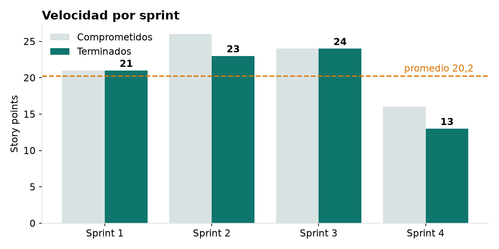
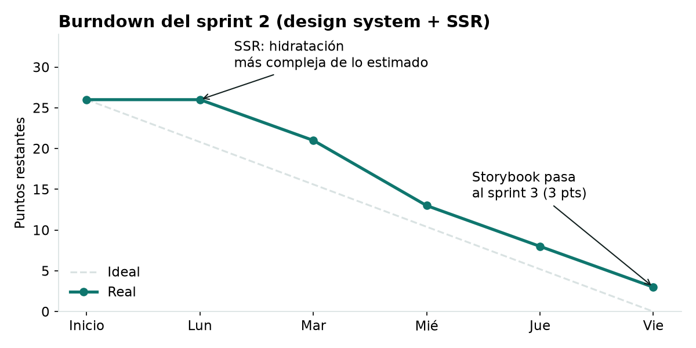

# 05 · Gestión y agilidad

> **Qué es real y qué es simulado.** El alcance, el backlog, los story points, el orden de los sprints, los riesgos y los bugs que
> aparecieron son reales: así se construyó Pulso. Lo trabajé sola, así que los roles de stakeholders, las ceremonias con equipo y el
> avance diario del burndown son **SIMULADOS** para mostrar cómo lo gestionaría con un equipo.

## Marco de trabajo

**Scrum con sprints de una semana** y un tablero Kanban para el flujo diario. Elegí sprints cortos porque el proyecto tenía un
plazo de 3 a 4 semanas: con sprints de dos semanas sólo habría dos revisiones y ningún margen para corregir el rumbo.

| Rol | Quién | Responsabilidad |
| --- | --- | --- |
| Product Owner | Virginia | Prioriza el backlog con RICE y define criterios de aceptación |
| Scrum Master | Virginia | Facilita ceremonias, mide flujo, quita bloqueos |
| Equipo de desarrollo | Virginia | Datos, API, frontend, diseño, QA |
| Stakeholders (SIMULADO) | Dirección comercial, CRM, cuentas | Validan en cada review |

### Ceremonias

| Ceremonia | Cuándo | Duración | Salida |
| --- | --- | --- | --- |
| Planning | Lunes | 45 min | Objetivo del sprint y compromiso en puntos |
| Daily (asincrónica) | Todos los días | 5 min | Qué hice, qué sigue, qué me bloquea |
| Review | Viernes | 30 min | Demo con datos reales |
| Retro | Viernes | 20 min | Una mejora concreta para el sprint siguiente |
| Refinamiento | Miércoles | 30 min | Historias del próximo sprint con criterios y estimación |

### Definition of Ready / Definition of Done

**Ready:** historia con formato "como… quiero… para…", criterios de aceptación, estimación en puntos (Fibonacci) y sin dependencias abiertas.

**Done:** código con tipos estrictos y sin errores de ESLint · tests unitarios del comportamiento nuevo · historia de Storybook si es un
componente · 0 violaciones de axe · revisado en celular · documentado si cambia una decisión.

## Backlog

7 épicas, 25 historias y 1 tarea; exportable a Jira con [`backlog-jira.csv`](backlog-jira.csv) (Importar → CSV, mapear *Epic Link* y *Story Points*).

| Épica | Historias | Puntos | Estado |
| --- | ---: | ---: | --- |
| Datos y modelo | 3 | 13 | Terminada |
| API GraphQL | 2 + 1 tarea | 8 | Terminada |
| Design system | 5 | 19 | Terminada |
| Tablero | 6 + 2 en backlog | 23 (+10) | Terminada |
| Asistente de datos | 1 | 5 | Terminada |
| Calidad y CI/CD | 3 | 11 | Terminada |
| Documentación y lanzamiento | 2 + 1 en backlog | 5 (+3) | En curso |

## Sprints

| Sprint | Objetivo | Comprometido | Terminado | Qué pasó |
| --- | --- | ---: | ---: | --- |
| 1 | Datos limpios y API respondiendo KPIs | 21 | 21 | Sin desvíos. La limpieza llevó más de lo pensado pero la API salió rápida |
| 2 | Design system y SSR funcionando | 26 | 23 | La hidratación con TanStack Query y React 19 tuvo un conflicto de versiones; la documentación en Storybook pasó al sprint 3 |
| 3 | Las cinco pantallas y el asistente | 24 | 24 | Incluye los 3 puntos arrastrados |
| 4 | Calidad, CI/CD y lanzamiento | 16 | 13 | axe y Playwright encontraron 3 bugs; el deploy en Render queda bloqueado por cuenta |

**Velocidad promedio: 20,3 puntos por sprint.**

## Kanban

| Por hacer | En curso (WIP ≤ 2) | En revisión (WIP ≤ 2) | Hecho |
| --- | --- | --- | --- |

El límite de WIP de 2 obligó a cerrar antes de abrir: cuando una historia quedaba trabada en revisión (por ejemplo, el mapa de calor
que fallaba axe), no se empezaba otra hasta resolverla.

**Métricas de flujo (sprint 4, SIMULADO a partir de los commits):** lead time promedio 2,1 días, cycle time 1,3 días, 0 historias
reabiertas después de Done.

## Riesgos

| Riesgo | Prob. | Impacto | Respuesta | Estado |
| --- | --- | --- | --- | --- |
| El CSV de 95 MB hace lento cada cambio en el modelo | Alta | Medio | Mitigar: precalcular agregados en SQLite (924 KB) y versionar la base, no el CSV | Cerrado |
| SSR sin framework se vuelve un pozo de tiempo | Media | Alto | Mitigar: timebox de 1 día; plan B, Next.js | Ocurrió parcialmente (3 pts arrastrados) |
| Comparaciones engañosas por falta de historia previa | Alta | Alto | Evitar: no comparar clientes nuevos contra la ventana inicial y explicarlo en la interfaz | Cerrado |
| El asistente responde algo incorrecto con seguridad | Media | Alto | Evitar: reglas fijas, consulta visible, tests por intención | Cerrado |
| Accesibilidad se deja para el final | Media | Medio | Mitigar: axe en la Definition of Done y en CI | Cerrado |
| Deploy depende de cuentas externas | Media | Bajo | Aceptar: el blueprint queda listo; se publica cuando estén las cuentas | Abierto |

## RACI (SIMULADO, con equipo)

| Entregable | PO | Desarrollo | Diseño | QA | Dirección comercial |
| --- | --- | --- | --- | --- | --- |
| Priorización del backlog | **A/R** | C | C | I | C |
| Modelo RFM y reglas de segmento | A | **R** | I | C | C |
| Design system | C | R | **A/R** | C | I |
| Tablero y SSR | A | **R** | C | C | I |
| Tests e2e y accesibilidad | I | R | C | **A/R** | I |
| Lanzamiento | **A** | R | I | C | I |

R = responsable, A = aprueba, C = consultado, I = informado.

## Retrospectivas

| Sprint | Funcionó | No funcionó | Mejora para el siguiente |
| --- | --- | --- | --- |
| 1 | Documentar las reglas de limpieza con conteo de filas | Estimé la limpieza en 3 y fue 5 | Spike de medio día antes de estimar trabajo con datos desconocidos |
| 2 | Tokens primero: el modo oscuro salió casi gratis | Instalar dependencias en dos pasos dejó dos versiones de React | Fijar versiones mayores en el primer `npm install` y revisar `npm ls` |
| 3 | Tests desde el rol accesible (`getByRole`) | El asistente confundía "en" dentro de "segmento" | Cada bug encontrado a mano se convierte en un test de regresión |
| 4 | axe en CI encontró problemas que a simple vista no se veían | El deploy quedó atado a cuentas externas | Pedir accesos en el sprint 1, no en el último |

## Relación con PMBOK

| Área | Cómo se aplicó |
| --- | --- |
| Alcance | MVP y "fuera de alcance" explícitos en [01-producto](../01-producto/README.md); backlog con épicas |
| Cronograma | 4 sprints de una semana con objetivo cada uno |
| Calidad | Definition of Done con tests, accesibilidad y revisión en celular; CI que bloquea |
| Riesgos | Registro con probabilidad, impacto, respuesta (evitar, mitigar, aceptar) y estado |
| Interesados | RACI y review semanal con demo |
| Comunicaciones | Daily asincrónica, review con datos reales, documentación en el repo |
